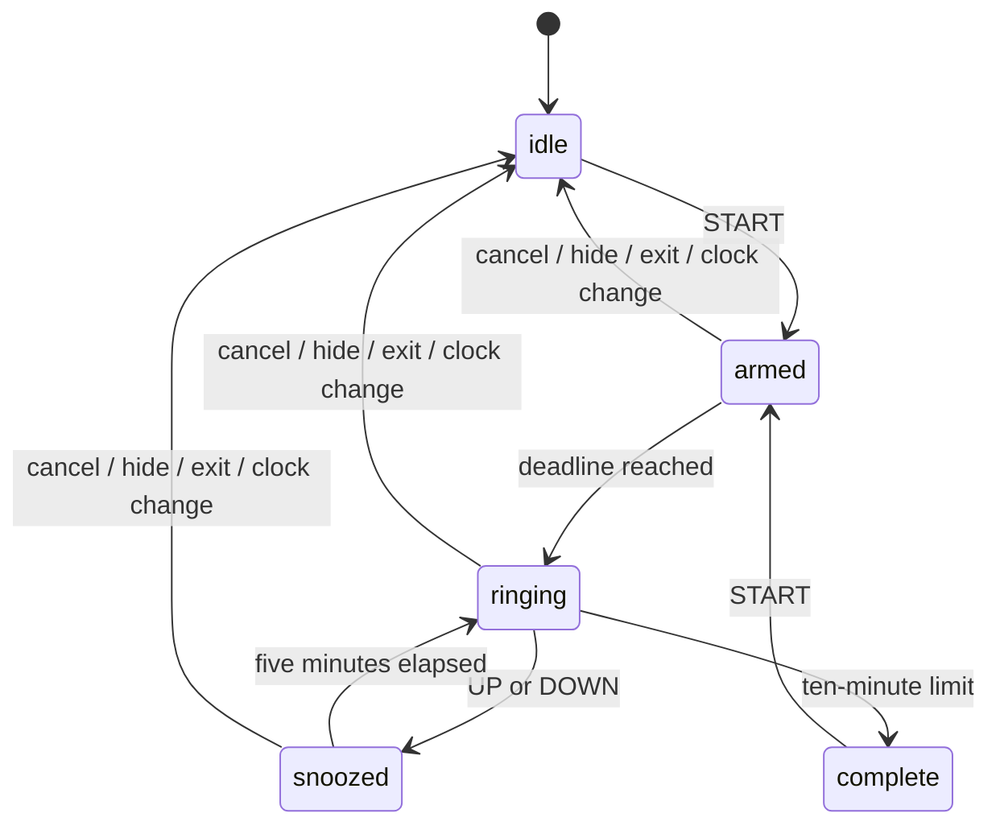

# Architecture

SoftRise is one foreground watch app with no external dependencies, backend, phone app, background service, or network permissions.

## Responsibilities

| File | Responsibility |
| --- | --- |
| `source/SoftRiseApp.mc` | Creates the alarm screen and stops alarm/lab activity at app exit |
| `source/AlarmEngine.mc` | Deterministic scheduling, three-tap sets, stage progression, snooze and completion; no hardware calls |
| `source/AlarmView.mc` | Settings, timers, clock checks, motor requests, screen rendering, battery snapshot and input delegates |
| `source/LabPlan.mc` | Experimental alarm and lab pulse parameters; intentionally separate patterns |
| `source/LabView.mc` | Bounded pulse comparisons and compressed lab sequence |
| `source/*Tests.mc` | Simulator regression tests with controlled clocks/motor boundaries |

## Alarm states

Hour/minute/ramp are persisted under `alarmSettings` as a three-element array and validated on loading. Armed state, motor requests, and battery snapshots are not persisted. Storage failures are handled with a visible message; failed saving at arm time disarms rather than pretending setup succeeded.

A repeating timer checks Unix wall time against the selected deadline and compares it to a monotonic timer to detect clock jumps. Local offset changes also disarm. Each callback requests at most one VibeProfile and schedules from the current time, avoiding missed-pulse bursts. Hidden views guard callbacks and stop the timer; returning does not rearm.

Stopping snapshots the battery only while an alarm is active. Later idle view changes must not rewrite the finished reading. The view shows the actual scheduled deadline during snooze rather than the original selected alarm time. Error messages take priority over battery text.

The engine's deterministic tests are separate from hardware evidence. A simulator passing a pulse-count assertion does not establish real pulse feel, sleep tracking, power use, or timer behavior during firmware interruptions.
